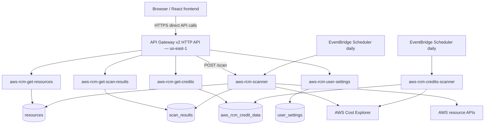

# CloudScope — Deployed Architecture (based on supplied Amazon Q report)

## High-level architecture

## Reported deployment facts

- API Gateway v2 HTTP API and backend compute are in `us-east-1`.
- Resource discovery spans `us-east-1` and `ap-south-1`.
- DynamoDB tables are in `us-east-1`, on PAY_PER_REQUEST billing.
- Frontend hosting on Amplify 
- Cognito user pool is reported as present. 
- Schedules: `aws-rcm-scheduled-scan` and `rcm-schedule-credit-scan`, each running at `rate(24h)`.

## Lambda functions

| Function | Reported memory | Timeout | Role |
|---|---:|---:|---|
| `aws-rcm-scanner` | 256 MB | 300 sec | Resource discovery and billing collection |
| `aws-rcm-credits-scanner` | 256 MB | 60 sec | Credit history collection |
| `aws-rcm-get-resources` | 128 MB | 30 sec | Read resource inventory |
| `aws-rcm-get-scan-results` | 128 MB | 30 sec | Read latest scan/billing data |
| `aws-rcm-get-credits` | 256 MB | 30 sec | Read credit history |
| `aws-rcm-user-settings` | 128 MB | 30 sec | Read/update preferences |

## DynamoDB tables

- `resources`: PK `resource_id` (String); report observed 27 items.
- `scan_results`: PK `scan_id` (String); latest record uses key `LATEST`.
- `aws_rcm_credit_data`: PK `pk` (String), SK `sk` (String); report observed 1,945 items.
- `user_settings`: schema not fully detailed in the supplied report.

