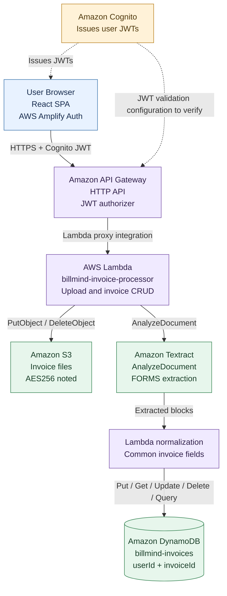

# BillMind — Architecture

## Overview

BillMind is documented as a serverless invoice-processing application deployed in AWS Region `the selected AWS Region`. The React single-page application uses AWS Amplify Auth for Cognito authentication. Requests pass through an API Gateway HTTP API to Lambda, which coordinates storage, text extraction, and database operations.

## Architecture diagram

## Architecture

## Components

| Component | Responsibility |
|---|---|
| React frontend | Uploads documents and displays extracted fields for user review |
| AWS Amplify Auth | Frontend authentication/token management |
| Amazon Cognito | User pool and JWT issuance |
| Amazon API Gateway HTTP API | HTTPS API entry point and route integration |
| `billmind-invoice-processor` Lambda | Document upload, extraction orchestration, invoice retrieval and mutation |
| Amazon S3 | Stores uploaded source documents |
| Amazon Textract | Extracts text and form key-value relationships |
| Amazon DynamoDB | Stores invoice metadata and extracted fields |

The supplied notes also name `billmind-bills-api` and `billmind-bills-api-role`. Confirm whether that function is active and what it handles before documenting it as part of the request path.

## Upload and extraction flow

1. The user selects a PDF, JPG, or PNG file in the frontend.
2. The frontend sends `POST /invoices/upload` with a Cognito bearer token.
3. API Gateway forwards the request to Lambda. The notes describe binary request handling through API Gateway's base64 representation.
4. Lambda validates the encoded body and allowed content type.
5. Lambda stores the file in S3 under a user/invoice-specific key.
6. Lambda calls Amazon Textract `AnalyzeDocument` with the `FORMS` feature.
7. The returned `LINE` and `KEY_VALUE_SET` blocks are parsed into raw text, key-value pairs, and normalized fields.
8. The invoice record is written to DynamoDB with a review status.
9. The frontend displays extracted fields for review and correction.
10. The user saves reviewed fields through `PUT /invoices/{invoiceId}`.

## API routes documented in the project notes

| Method | Route | Intended action |
|---|---|---|
| `POST` | `/invoices/upload` | Upload document, extract fields, create invoice record |
| `GET` | `/invoices` | List the authenticated user's invoices |
| `GET` | `/invoices/{invoiceId}` | Fetch a single invoice |
| `PUT` | `/invoices/{invoiceId}` | Update reviewed fields |
| `DELETE` | `/invoices/{invoiceId}` | Delete invoice record and stored file |

The notes state that all routes require a Cognito ID token/JWT. Verify API Gateway authorizer configuration and authorization claims in the deployed environment before treating this as independently validated.

## Data model

The supplied design notes describe a DynamoDB table named `billmind-invoices` with:
- Partition key: `userId` (string; described as the Cognito `sub` claim)
- Sort key: `invoiceId` (string; UUID)
- Billing mode: `PAY_PER_REQUEST`

Fields described include `s3Key`, `contentType`, `fileSize`, `status`, `rawText`, `extractedLines`, `kvPairs`, `extractedData`, normalized invoice fields, notes, timestamps, and optional line items. Confirm the deployed table schema and actual fields against the code.

## Error handling documented in the notes

| Failure | Documented behavior |
|---|---|
| Non-base64 upload | Reject with HTTP 400 |
| Unsupported content type | Reject with HTTP 400 |
| Textract failure | Delete uploaded S3 object and return an error |
| Initial DynamoDB write failure | Delete uploaded S3 object and return an error |
| Update/delete for missing invoice | Return HTTP 404 using a condition expression |
| S3 deletion fails after database deletion | Return an error indicating partial deletion |

These behaviors are summarized from supplied project notes and have not been independently tested here.

## Security considerations to verify

- JWT authorizer is enabled on every intended route.
- The backend derives user identity from validated claims rather than trusting a client-supplied user ID.
- DynamoDB queries and mutations enforce record ownership.
- S3 bucket public access is blocked and encryption settings match the documentation.
- Lambda roles grant only the actions and resources required.
- Error responses do not expose tokens, raw secrets, or unnecessary personal invoice data.
- Real invoice documents and OCR output are not committed to the public repository.
