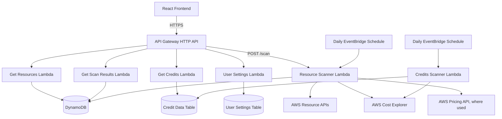

# CloudScope — AWS Resource & Cost Monitor

CloudScope is a serverless AWS visibility application that brings resource inventory and billing information together in one dashboard.

## What It Does

- Displays discovered AWS resources across configured regions.
- Shows recorded costs for the current billing period.
- Breaks down spending by AWS service and region.
- Presents AWS month-end cost forecasts where available.
- Displays recorded AWS credits.
- Allows additional AWS regions to be configured through Settings.

## Architecture

## AWS Services and Components

| Component | Purpose |
|---|---|
| AWS Lambda | Resource scanning, billing collection, API handlers, and credit collection |
| Amazon API Gateway | HTTP API for frontend requests |
| Amazon DynamoDB | Stores resource inventory, scan results, user settings, and credit records |
| AWS Cost Explorer | Provides billing data, service breakdowns, trends, and forecasts |
| AWS Pricing API | Supports pricing lookups where used |
| Amazon EventBridge Scheduler | Runs scheduled resource and credit collection workflows |
| Amazon Cognito | Authentication integration |

## API Endpoints

| Method | Endpoint | Purpose |
|---|---|---|
| GET | `/resources` | Retrieve discovered resources |
| GET | `/scan-results` | Retrieve scan results and billing summaries |
| POST | `/scan` | Trigger a resource scan |
| GET | `/credits` | Retrieve credit records |
| GET | `/settings` | Retrieve user settings |
| PUT | `/settings` | Update user settings |

The API base URL and route configuration should be confirmed against the deployed API before being published.

## Data Storage

- **`resources`** — discovered AWS resource records, keyed by `resource_id`.
- **`scan_results`** — scan summaries and billing information, keyed by `scan_id`.
- **`aws_rcm_credit_data`** — credit records, keyed by `pk` and `sk`.
- **`user_settings`** — user preferences for the application.

## Resource Discovery

CloudScope's default scan regions are:

- Asia Pacific (Mumbai) — `ap-south-1`
- Asia Pacific (Hyderabad) — `ap-south-2`
- US East (N. Virginia) — `us-east-1`

Additional AWS regions can be configured from the Settings page.

## Engineering Highlights

- **Resource inventory:** Discovers supported AWS resources across configured regions.
- **Cost visibility:** Combines recorded AWS spending with service-level and regional breakdowns.
- **Forecasting:** Displays AWS cost forecasts where available.
- **Serverless architecture:** Uses AWS Lambda and API Gateway for backend processing and API access.
- **Scheduled collection:** Supports automated resource and credit scanning.
- **Configurable regions:** Lets users expand resource discovery through Settings.

## Security and Reliability

CloudScope uses AWS-managed services and identity integrations as part of its architecture. Authentication and authorization, IAM permissions, monitoring, error handling, and secret management are important considerations when operating and extending the application.

## Project Status

CloudScope is currently in **hibernation**. Active development is paused, but the project remains documented as part of my AWS cloud engineering portfolio.
